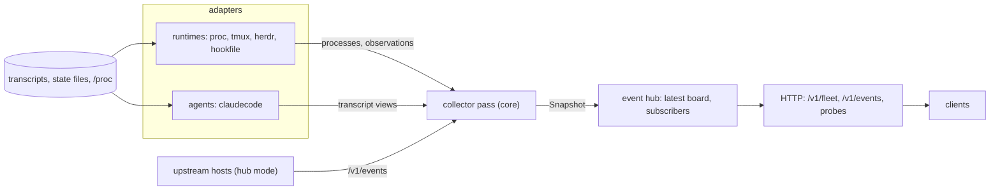

# Architecture

FleetWatch is one Go process that polls the machine it runs on, builds a board of agent sessions, and serves the board over HTTP. It reads only. The code is the standard library and nothing else (ADR-006).

## Shape

The adapters sit on the left and know nothing about HTTP. The collector in `internal/core` consumes them only through the interfaces in `internal/host` and `internal/agent`. The event hub (the `Hub` type in `internal/core/hub.go`, unrelated to hub mode) holds the newest board and fans it out to `/events` subscribers.

## The poll loop

`internal/core/server.go` runs one pass every `poll` (2 seconds by default), or sooner when a runtime that can push (herdr) wakes it. A burst of wakes settles into one early pass. Each pass:

1. Calls the collector, which returns a `Snapshot`.
2. Marshals it with the timestamp zeroed and compares the bytes with the previous body, so only a real change publishes a new `board` event; otherwise subscribers get a `tick`.
3. Records the pass in the health state. `/health` is unhealthy when no pass has completed within five poll intervals plus ten seconds.

A panic inside a pass is recovered, logged and counted as a failed pass, so one bad transcript cannot stop the service.

## The collector pass

`Collector.Collect` (`collect_assemble.go`) runs these stages in order.

| Stage | What happens |
|---|---|
| Discover | Each runtime lists agent processes. The agents are asked, in config order, whether a process is theirs (`Claims`). The first runtime to report a pid owns it. |
| Bind exact | Each agent binds a process to a session only on proof, such as Claude Code's `sessions/<pid>.json`. Processes are visited newest first. |
| Observe | Each runtime that implements `Observer` returns what it knows about the bound sessions: a pane address, state signals, a context reading. |
| Tail | Each agent rescans its transcript index on a cadence and reads new bytes of every transcript touched within `window`. |
| Bind guess | A process nothing could place takes the newest unclaimed transcript active since it started. The board marks these `link: guess`. |
| Assemble | Views are built for live and recently ended sessions. State is merged (below), then subagents, messages between sessions, cost, issues and worktrees are joined. |
| Finish | Counts, accounts, branches, the log and links are derived over the views. Free text is redacted and clipped as each view is built. |

## Two adapter kinds

A **runtime** (`internal/host`) answers "where do agent processes live, and what does that place know about them". It never reads transcripts. The required interface is small, and a runtime opts into more by implementing optional interfaces that the core discovers by type assertion.

| Interface | Purpose |
|---|---|
| `Runtime` | `Name` and `Sessions`: discover processes |
| `Observer` | per-pass observations for bound sessions |
| `Watcher` | wake the poll loop early |
| `ConfigDirSource` | add agent config directories |
| `ActivitySource`, `ContextSource` | late lookups by session id and a statusline cache |

An **agent** (`internal/agent`) answers "what is this process running, and what has it done". It owns the transcripts and folds them into views: state floor, tools, subagents, cost, log. The split lets a new agent reuse every runtime and a new runtime serve every agent (ADR-002). Adapters are registered by name in `internal/registry`; [adapters.md](adapters.md) shows how.

## Ranked state merge

Several sources can claim a session's state at once: the transcript, a screen scrape, herdr, a hook file. Each claim is a `StateSignal` with a rank, and `mergeState` picks the winner by a fixed rule (ADR-003): drop signals past their `FreshUntil`, take the highest rank, and break a tie with the newer `ObservedAt`.

| Rank | Constant | Source |
|---|---|---|
| 50 | `RankNative` | a state file written by the agent's own plugin (`hookfile`) |
| 40 | `RankHook` | available to adapters for hook-derived signals; no public adapter emits it |
| 30 | `RankProjection` | available to adapters for a projection supplied by a launcher; no public adapter emits it |
| 25 | `herdr.RankScreen` | herdr's screen-detected state (configurable between 11 and 29) |
| 20 | `RankPane` | a tmux screen scrape |
| 10 | `RankTranscript` | the agent's reading of its transcript, the floor every session has |
| 0 | `RankProcess` | "starting": a process with no transcript yet |

After the merge, a `waiting` session that has waited more than 30 minutes becomes `idle`, and a session that will act again on its own (a timer or a pending background task) is reported as `working`, so that `waiting` always means the human's move. A signal that carries an expiry stops winning once it lapses, which is how a crashed session's last write is retired.

## Hub mode

With a `hub` section the same loop collects from other FleetWatch instances instead of, or as well as, the local machine. A `Source` in `internal/upstream` follows one upstream's `/v1/events` stream with a bearer token, and `Merge` folds the boards into one `Snapshot`. See [hub.md](hub.md).

## Boundaries that keep it small

| Package | Responsibility |
|---|---|
| `cmd/fleetwatch` | entry point and the optional-adapter registration files |
| `internal/core` | collector, poll loop, HTTP routes, token, recap, hub source |
| `internal/config` | strict config loader, adapter decoders, environment |
| `internal/registry` | adapter registration and the strict-decode helper |
| `internal/host`, `internal/agent` | the two adapter interfaces |
| `internal/host/*`, `internal/agent/claudecode` | the built-in adapters |
| `internal/board` | the wire types served to clients; frozen by golden snapshots and served under `/v1` |
| `internal/upstream` | the hub's follower and merge |
| `internal/forge`, `internal/models` | issue lookups, and the config-driven model table |
| `internal/fsafe`, `internal/httpsafe`, `internal/textsafe` | safe file reads, HTTP client policy, redaction and clipping |
| `internal/policy` | repository-wide guard tests |
| `internal/fleettest` | test support that fabricates transcripts |

The wire types in `internal/board` are the contract with every client. Golden snapshots under `internal/core/testdata/golden` fail a test when the board changes, so a change to the contract is always deliberate and visible in the diff.
